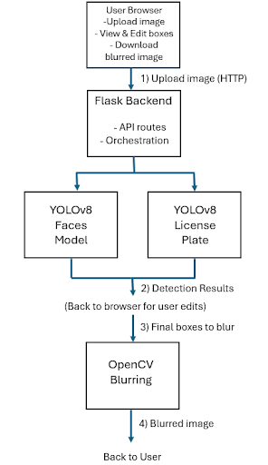
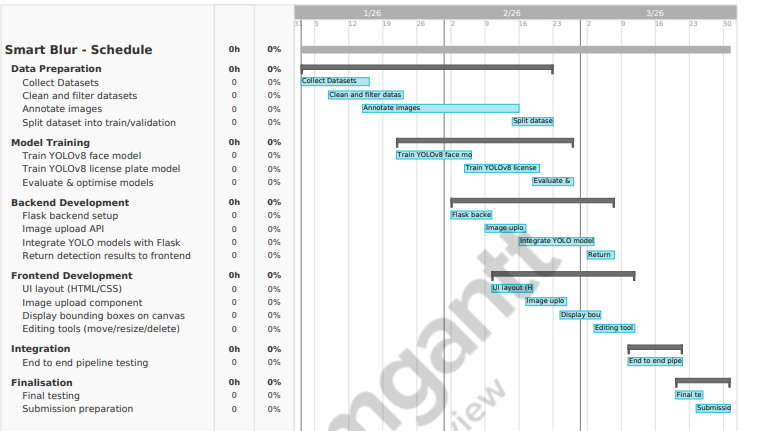
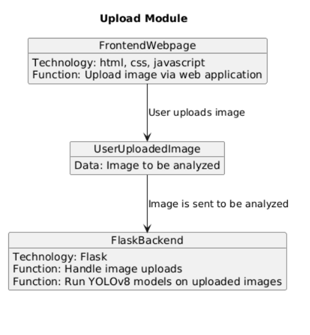
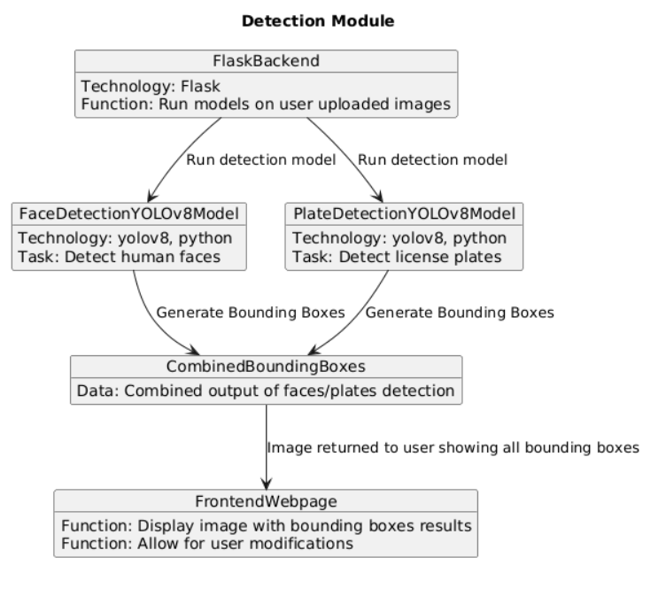
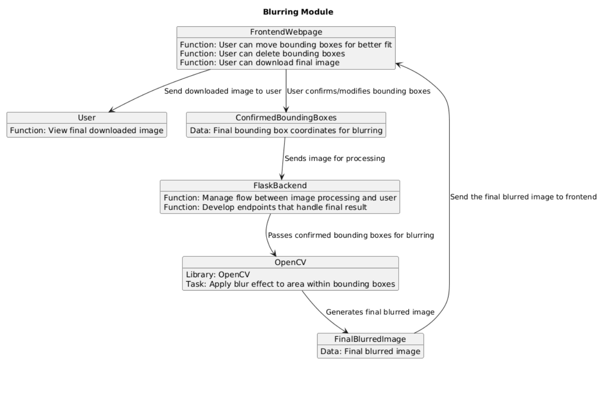
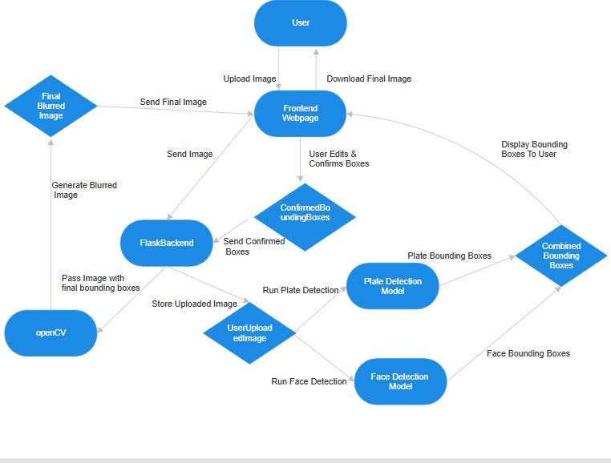

# Project title: Smart Blur

Student1: Liam Wrafter
StudentID: 22411932
Student2: Tom Clarke
StudentID: 22388923
Project Supervisor: Sunder Ali Khowaja
Document: Functional Specification
Date Finished: 26/11/2025 

## Table of contents
1. [Introduction](#1-introduction)
   - [Overview](#11--overview)
   - [Business Context](#12--business-context)
   - [Glossary](#13--glossary)
2. [General Description](#2-general-description)
   - [Product / System Functions](#21-product--system-functions)
   - [User Characteristics and Objectives](#22-user-characteristics-and-objectives)
   - [Operational Scenarios](#23-operational-scenarios)
   - [Constraints](#24-constraints)
3. [Functional Requirements](#3-functional-requirements)
4. [System Architecture](#4-system-architecture)
   - [Architectural Overview](#41-architectural-overview)
   - [Components and Their Roles](#42-components-and-their-roles)
   - [Data Flow Description](#43-data-flow-description)
   - [Architectural Diagram](#44-architectural-diagram)
   - [Reused or External Components](#45-reused-or-external-components)
5. [High-Level Design](#5-high-level-design)
6. [Preliminary Schedule](#6-preliminary-schedule)
7. [Appendices](#7-appendices)
   - [Object Diagrams](#71-object-diagrams)
   - [DFD Diagram](#72-dfd-diagram)

## 1. Introduction
### 1.1  Overview

Smartblur is a web-based image privacy tool that is designed to automatically detect and 
anonymize sensitive information in images such as human faces and vehicle license plates. 
The need for an accessible and simple image privacy tool has grown due to the increasing need to protect personal data. In many industries such as journalism, 
legal environment, healthcare and general online content sharing over social media, manually censoring images is very time consuming. 
Smartblur provides an automated, reliable solution that reduces this workload. 

Smartblur compromises of many functionalities such as:
 	
1. SmartBlur allows users to upload an image through a simple and accessible web application.
2. The system uses two trained YOLOv8 models to automatically detect sensitive regions in user uploaded images.
3. These results are displayed to the user and the webpage allows for them to move, delete and confirm the results.
4. The confirmed bounding boxes are blurred using the OpenCV library.
5. This final blurred image is returned to the user where they are able to download it via the webpage.

SmartBlur is a client-server system in which the web-based frontend communicates with a flask backend. The backend runs the face detection and license plate detection models, handles the uploaded images and conducts the blurring operations. By offering an easily accessible, browser-based interface SmartBlur can be used by any individual or organizations that want a quick automated image privacy tool.

### 1.2  Business Context

Our system SmartBlur is designed to operate within areas where image privacy, personal/business data protection and regulatory compliance are important. Although our system is not sponsored by any business organization, we have identified multiple areas in which our project could be deployed in real world business contexts.

**Journalism Organizations**

Journalists and media organizations often work with images that contain the faces of individuals or sensitive objects such as license plates. Our system Smartblur would allow journalists to quickly redact sensitive regions such as faces and license plates before publishing images for privacy and preventing unintentional exposure of individuals.

**Legal Environments**

Smartblur can also be used by lawyers, judges and investigative teams who often handle sensitive photographic evidence containing individuals. Smartblur can be used to redact individuals faces and license plates in order to secure individuals privacy before the release of materials such as court documents.

**Healthcare environments**
	
Doctors and medical professionals will on occasion need to share medical images that contain patient faces. Smartblur can keep the anonymity of these patients before these medical images are used for consultations or medical publications.

**Individual Users**

Smartblur can also be used by individuals who are increasingly concerned about  data privacy online and on social media. Smartblur provides a simple and accessible way to help users keep their privacy when sharing images of themselves, family members or friends online.

### 1.3  Glossary

Define and technical terms used in this document. Only include those with which the reader may not be familiar.

## 2. General Description
### 2.1 Product / System Functions
The smart blur system is a web-based privacy tools which is designed to automatically detect and blur sensitive visual information in images, specifically human faces and vehicle license plates. The system combines deep-learning-based object detection with a user driven verification workflow to ensure accurate and controllable redaction.

At a general level the system will provide the following functionality:

- **Image Upload:** Users can upload images through a simply designed web interface.
- **Automated detection:** Two YOLOv8 models, one trained for faces and the other trained for licence plates run interference on the uploaded images.
- **Display of Detected Regions:** Detected faces and licence plates are highlighted with bounded boxes for the user to look over and review.
- **User Adjustment of the bounding boxes:** The user can reposition, resize, or remove bounding boxes before blurring to ensure accuracy.
- **Blurring:** After confirmation, OpenCV applies a blur effect to each of the selected region/regions.
 
### 2.2 User Characteristics and Objectives

The smart blur system is intended for a wide range of different users. Some of these users may frequently handle images containing personal or identifiable information. Expected technical expertise varies, but the interface is designed so that users with minimal technical or image editing experiences can operate the system easily.

**User Characteristics**

- **General User:**
Users may have limited understanding of image processing or machine learning concepts. Requires a simple workflow for uploading images and confirming the blur regions. Values speed and accuracy over customization.

- **Professional Users:**
This may include journalists, legal professionals, healthcare workers, and small businesses. These people may often deal with sensitive or confidential imagery that must be anonymized before distribution. Requires high reliability and the ability to manually verify detected regions.

**User Objectives**

- **Accurate Automatic Detection:** Quickly detect faces and license plates with minimal manual effort. 

- **Manual Control:** Ensure certain detections can be removed and missed regions can be corrected.

- **Fast Processing:** The multi-step workflows from uploading to detection to blurring should feel responsive. 

- **Privacy Assurance:** Users want confidence that the final image hides all sensitive areas that they've confirmed.

### 2.3 Operational Scenarios

**Scenario 1: Standard Image Processing**
1. A user opens the Smart Blur web application.

2. The user uploads an image from their computer/laptop.

3. The backend processes the image through both YOLOv8 models.

4. The system displays the image with bounding boxes around detected faces and license plates.

5. The user reviews detections and adjusts any necessary box sizes.

6. Once satisfied, the user clicks Confirm & Blur.

7. The backend applies OpenCV blurring to all final regions.

8. The processed image is displayed and the user downloads it.

**Scenario 2: Model Misses a Detection**
1. A user uploads an image of a group photo.

2. The detection model identifies most, but not all faces.

3. The user manually adjusts where necessary:

4. Deletes a false detection.

5. Adds a missing bounding box.

6. The corrected bounding boxes are sent to the backend.

7. The system applies blurring correctly across both auto and manually-selected regions.

**Scenario 3: Incorrect Bounding Box Placement**
1. A license plate is partially detected.

2. The bounding box only covers a small portion of the license plate.

3. The user resizes the bounding box to correctly capture the full area.

4. The user confirms the edit.

5. The blur is applied to the full corrected region.

### 2.4 Constraints
The smart Blur system must operate under several different technical and performance constraints.

**Performance Constraints**

The Yolov8 interference must complete quickly, if there is a long delay it will affect usability in a negative way. Large images may increase the processing time and memory usage. The Browser-side interaction with bounding boxes must also remain responsive.

**Hardware/Software constraints**

The system runs on a Flask backend; so the model interface must operate within Python’s environment. Models must be optimized to run on CPU-only environments. Browser compatibility must be maintained for common desktop browsers like Chrome, Firefox, Safari and Edge.

**Data and Security Constraints**

Images uploaded must be processed securely and not stored. The system must be able to handle corrupted or unsupported files in a graceful manner. User data should not be shared with any third parties.

**Development Constraints**

There is a limited project duration. Two-person team with divided responsibilities. There are numerous learning requirements (e.g. YOLOv8, Flask, OpenCV, frontend tools).

### 3. Functional Requirements
**Image upload**
Description:
Our system allows users to upload images via the web-based interface for analysis. This involves supporting actions such as selecting an image, validating the image and then sending that image to the backend flask server for processing.

Criticality:

The entire flow of the system relies on having an image to analyse.

Technical issues:

1. The upload needs to support common image formats such as jpg or png.
2. The file size may have to be limited in order to prevent server overload.
3. Corrupted images files that have been uploaded must be handled correctly.

Dependencies:

1. The image upload interacts with the Frontend Interface for image selection.
2. TheObject detection requires the user uploaded image to run the face detection and               license plate detection YOLOv8 models on the image.

**Face and license plate detection**
Description:

The system must run inference using two different YOLOv8 models, one for detecting faces and the other for detecting license plates, to automatically detect those sensitive regions in the user uploaded image.

Critically:

The face and license plate detection is the core functionality of this project.

Technical Issues:

1. The most important is ensuring that the trained YOLOv8 models are accurate and optimized for efficiency.
2. Slow inference may frustrate users.
3. Uploaded images require proper preprocessing before running the models such as converting the image to the proper YOLO format.

Dependencies:

1. This requirement is dependent on the image upload as this provides the input for the YOLOv8 models.
2. The Display Bounding Boxes requirement uses the output of the object detection models to present the results to the user.

**Display bounding boxes to user**
Description:

After the detection is completed the system must display the resulting bounding boxes around the sensitive areas on the frontend web-based interface before the areas are blurred. This step allows users to visually confirm or modify the detected areas.

Critically:

This step is required for the user review and for error prevention.

Technical issues:

1. The bounding box coordinates must be converted to frontend-friendly coordinates.
2. Rendering the image with the coordinates must be accurate as well as responsive.
3. The bounding box alignment on different screen sizes.

Dependencies:

1. The Object Detection provides the bounding box coordinates that are to be sent to the user for confirmation or modifying.
2. The User Editing of these bounding boxes relies on these bounding boxes to be displayed for user modifications or confirmation.

**User editing of the bounding boxes**
Description:

The system must allow for users to manually adjust the resulting bounding boxes of their uploaded images. Users should have the ability to move the bounding boxes, adjust the size of the bounding boxes and delete bounding boxes.

Critically:

High critically as this ensures accuracy and prevents unwanted regions getting blurred. 

Technical issues:

1. This requires an interactive javascript-based fronted tool.
2. If the bounding boxes have been edited the new coordinates must be returned to the backend in the correct format.
3. here must be pixel-perfect accuracy between sending the results from the frontend to the backend.

Dependencies:

1. Relies on the displaying of the bounding boxes requirement to function correctly.
2. The blurring of sensitive regions relies on the output of the user modified boxes or the user confirmed boxes.

**Blurring Regions**
Description:

The system must blur the area enclosed in all the bounding boxes after the user has confirmed the area. The blurring process involves using OPenCV to apply blur to the area.

Critically:

This is a critical part as it's the main output of the whole system.

Technical issues:

1. OpenCV must correctly map the bounding box coordinates onto the image.
2. Performance optimization is required in order to guarantee fast image outputs.

Dependencies:

1. This relies on the output of the user editing the final bounding box coordinates.
2. The returning of the final image needs this to present the final blurred image output to the user. 

**Return finished image to user**
Description:

Once the system has applied the blur, the system must return the final processed image to the user via the web-based interface. The user will then be able to download the image.

Critically:

This criticality is high due to this stage delivering the final output to users.

Technical issues:
1. All images must be returned in the correct format such as jpg or png.
2. Files served through Flask must be done securely.

Dependencies:

1. Relies on the blurring of the sensitive regions inside the bounding boxes.
2. Works with the frontend interface in order the display the final results to the user as well as the ability for the user to download the image.

Web interface
Description:

The system must provide a simple web interface in order to allow users to upload images, view inference results, modify/delete resulting bounding boxes and to view and download the final results.

Critically:

This is high criticality as this part determines overall user experience as well as the usability of the whole system.

Technical issues:

1. The frontend html/css/javascript must be integrated with the flask backend.
2. The web ui must handle image uploads without lag.
3. Most importantly the web interface must support file selection.

Dependencies:

1. All other requirements depend on this requirement as it serves as the starting point for user interactions.

**Backend integration with YOLO models**
Description:

The flask backend must manage multiple components such as receiving user uploaded images, run the trained models for object detection, handle the user edits, apply blurring with OpenCV and return the final image back to the user.

Critically:

This stage is critical as every core functionality relies on the backend.

Technical issues:
1. Ensuring compatibility between the python environment, the YOLOv8 models and the flask backend.
2. Prevent server disruptions when processing large images.

Dependencies:

1. The image upload, the automatic face and license plate detection detection, the blurring of sensitive areas and returning of the downloaded image rely on this requirement.

**Model training and dataset preparation**
Description:

The system development process requires cleaning and formatting datasets into the required YOLO format and then using the corrected datasets to train the face detection model and the license plate detection model.

Critically:

This is highly critical as it is required for detecting the regions.

Technical issues:

1. The datasets must be high-quality and correctly annotated for model training.
2. Optimization is required in order for the model to be efficient.

Dependencies:
 
1. This requirement is needed for the automatic face detection in order to be able to detect faces and license plates in the images uploaded by users.

## 4. System Architecture
### 4.1 Architectural Overview

The system contains four main modules:

1. Frontend Web Interface
2. Flask Backend Server
3. Object Detection Module (YOLOv8 Models)
4. Image Processing Module (OpenCV)

These modules will communicate in a pipeline, with each stage of the pipeline feeding output into the next. The architecture supports a semi-automated workflow where the backend handles detection, and enables the user to modify and validate the image before final processing.

### 4.2 Components and Their Roles
**1. Frontend Web Interface (HTML/CSS/JavaScript)**
The frontend of Smart Blur acts as the main user-facing component, which provides a simple user interface through which users can upload images, review detection results and do adjustments. When an image is uploaded, the frontend sends it to the backend for processing and then later displays the detected bounding boxes. Users can then resize or remove the boxes if they want. Once the user finalizes their edits the updated coordinates are sent back to the backend for blurring.

**2. Flask Backend Server**
The Flask backend operates as the main component of the system. It receives the image files from the frontend and then prepares them for analysis, such as decoding the image and formatting it for the object detection models. After preparing the image, the backend runs it through the detection pipeline and returns the output bounding box data to the frontend. Also then, the backend accepts modified bounding box coordinates from the user and coordinates with OpenCV to apply the blurring to the requested regions. It is also responsible for managing file transmission, ensuring that processed images are returned to users securely. As the central component, the backend manages all communication between system components and ensures that each stage of the workflow is completed smoothly and reliably.

**3. Object Detection Module (YOLOv8 Models)**
The object detection module consists of two YOLOv8 models, one trained to detect human faces and the other to detect vehicle license plates. These models are created into memory when the backend starts and is used to analyze each image. The models return bounding box coordinates which are then provided to the frontend for user review. This module provides the automation that is the foundation of the system, enabling users to quickly identify sensitive regions without having to manually mark them. Its performance will directly influence the effectiveness of the Smart Blur workflow.

**4. Image Processing Module (OpenCV)**
OpenCV is responsible for performing the actual blurring of sensitive regions once the user confirms the final set of the bounding boxes. The backend provides OpenCV with the original image and the list of approved coordinates, after which OpenCV applies a blur to the areas. This module ensures that sensitive data is fully obscured with pixel precision, making it suitable for environments where privacy compliance is an essential. Its output is then encoded into a standard image format and returned to the frontend for display and download. The OpenCV module produces the end result of the image that ensures the system’s primary anonymization goal.

### 4.3 Data Flow Description

The smart blur system follows a clear, linear data flow that first begins with the user uploading an image and then eventually ends with a final blurred image being returned to the user. Each component of the architecture design plays a specific role in processing, and validating the data as it moves through our system. The following description below outlines the flow of data across all the different modules.

The process of data begins at the frontend web interface, where the user selects and uploads an image through their browser. The image is then sent to the Flask backend via a HTTP POST request. Once its received, the backend temporarily decodes and preprocesses the image so that it can then be passed on to the detection pipeline. The backend then sends the image through the YOLOv8 face detection model and the YOLOv8 license plate detection model, then each returns predictions in the form of bounding box coordinates, labels and confidence scores. The backend combines these results and returns them to the frontend as structured data, alongside the original image that's for display.

When the detection results appear in the browser, the user can adjust the bounding boxes if they want by moving, resizing, or removing them. These user-edited coordinates are then sent back to the backend in a second HTTP request. At this point, the backend validates the coordinate data and hands both the edited coordinates and the original image to the OpenCV image processing module. OpenCV applies the blur effect to each region defined by the final bounding boxes inputted and returns the processed image to the backend.

Finally, the backend encodes the blurred image into a downloadable format and sends it back to the frontend via a HTTP response. The user can then view the result in the browser and download the anonymized image. Then the data flow completes, and no further processing is performed unless the user repeats the workflow with a new different image.

This pipeline ensures that data always flows in a controlled and secure way from the user to detection, from detection to verification, from verification to blurring and finally back to the user.

### 4.4 Architectural Diagram

### 4.5 Reused or External Components

Our Smart Blur system relies on several different external frameworks, libraries, and other tools that provide essential functionality for object detection, image processing, and backend to frontend communication. These components reduce the development effort involved and ensure that complex tasks and requirements are handled by well-supported technologies.

**YOLOv8 (Ultralytics)**

* This provides the deep learning architecture used for the face and license plate detection.

* Offers pretrained model structures, training utilities, and an efficient inference engine.

* Built on top of PyTorch, enabling fast GPU/CPU execution.

* Removes the need to design custom detection algorithms from scratch.

**PyTorch**

* Serves as the machine-learning framework powering YOLOv8 models.

* Handles tensor operations, model loading, and hardware acceleration.

* Provides stable support for training and inference.

**OpenCV**

* Used for applying blur to confirmed bounding boxes.

* Provides functions for Gaussian blur, pixelation, cropping, masking, and region manipulation.

* Removes the need for custom image-processing algorithms.

**Flask (Python Web Framework)**

* Acts as the backend server handling routing, image uploads, detection requests, and the image delivery.

* It manages communication between the frontend, YOLO models, and OpenCV.

* It's lightweight, easy to integrate, and suitable for rapid development.

**Frontend Technologies (HTML, CSS, JavaScript)**

* Provides the user interface for uploading images and interacting with bounding boxes.

* JavaScript and HTML canvas support dynamic rendering and editing of detection boxes.

* Browser-native features eliminate the need for external UI frameworks.

**NumPy**

* Supports numerical operations within the backend (e.g., array manipulation for images).

* Underpins OpenCV and PyTorch operations.

## 5. High-Level Design 

**High level components**
1. FrontendWebpage: A simple ui built using HTML, CSS and javascript for users to upload images, display bounding box results from object detection models, allow for editing of bounding boxes and downloading of the final results.
2. FlaskBackend: A python web framework that receives the user image uploads, runs both object detection models, sends detection results to the frontend webpage and accepts the returned confirmed bounding boxes and applies blur to the sensitive regions. 
3. FaceDetectionYOLOv8Model: A YOLOv8 python based object detection model that is trained to detect faces in images.
4. PlateDetectionYOLOv8Model: A YOLOv8 python based object detection model that is trained to detect license plates in images.
5. CombinedBoundingBoxes / ConfirmedBoundingBoxes: Data object carrying detection results and user modified/confirmed bounding boxes coordinates.
6. OpenCV: An image processing component that applies the blur to final bounding boxes.
7. FinalBlurredImage / UserUploadedImage: These are the image objects of both the initial raw user uploaded image and the final blurred image.
	
**Object Diagrams**

Upload module (7.1.1):
The upload module demonstrates how the FrontendWebpage interacts with the FlaskBackend. The upload module represents the initial stage of the system. The FrontendWebpage allows for users to upload their desired image for processing.
	
How objects relate:
* The user uploads their desired image through the FrontendWebpage. 
* The FrontendWebpage creates an UserUploadedImage object.
* This UserUploadedImage object is then sent to the FlaskBackend, which receives this object and stores it for the detection process.
	
Detection module (7.1.2):
The detection module object diagram shows the stage in which the two trained YOLOv8 models analyse the user uploaded image.

This shows how the flask backend interacts with the two YOLO models, one for detecting human faces and the other for detecting license plates and how the outputs of both of these models are combined before being displayed to the user.

How objects relate:
		
* The FlaskBackend sends the uploaded image to both the FaceDetectionYOLOv8Model and the PlatDetectionYOLOv8Model.
* Each model analyses the image and generates their own bounding boxes.
* These outputs are merged into a single object called CombinedBoundingBoxes.
* The CombinedBoundingBoxes object is then returned to the FrontendWebpage for the user to modify or confirm.

Blurring module (7.1.3):

The blurring module diagram shows where the final confirmed regions are blurred using OpenCV. This diagram models the interaction between the user, the FrontendWebpage, the FlaskBackend, OpenCV and the  FinalBlurredImage object.

How objects relate:

* The user adjusts the bounding boxes on the FrontendWebpage.
* The adjusted bounding boxes are saved as ConfirmedBoundingBoxes, which are then sent back to the FlaskBackend.
* The FlaskBackend sends the ConfirmedBoundingBox coordinates to OpenCV.
* OpenCV then generates a FinalBlurredImage which is sent to the FrontendWebpage.
* The user is then able to download this FinalBlurredImage.

DFD Diagram (7.2):

The data flow diagram shows the end-to-end flow of information through the entire  SmartBlur system. This DFD emphasises how data moves dynamically between processes during execution.

The diagram begins with the user uploading an image through the frontend webpage. The uploaded image is then sent to the flask backend, which stores it and forwards it to the face detection model and the license plate detection model. These models output bounding boxes which are then combined into one image and returned to the frontend for user review and modification. After the user confirms or edits the bounding boxes, it's sent back to the flask backend and is passed to OpenCV to generate the blurred image. The final completed image is then returned to the frontend webpage for the user to download.

## 6. Preliminary Schedule

Development consists of 5 main phases:

**Data preparation:**
	
This phase involves acquiring and preparing the datasets that are required for the training of the YOLOv8 models. 
	
Main tasks:
	
Collecting datasets.
Cleaning and properly formatting images.
Annotating Images if needed.
Splitting datasets into training and testing datasets.

**Model Training:**
	
Using the prepared datasets, the two YOLOv8 models for face detection and license plate detecting are trained and evaluated for their accuracy.
	
Main tasks:
	
1. Training YOLOv8 face detection model.
2. Training YOLOv8 license plate detection model.
3. Evaluating results and refining hyperparameters.

**Backend Development:**

This phase focuses on building the flask backend that runs the trained YOLOv8 object detection models and processes user uploaded images.
Main tasks:
	
1. Setting up the flask backend.
2. Implementing image uploads.
3. Integrating the trained YOLOv8 models within the flask backend.
4. Returning model results to the frontend

**Frontend Development:**
	
This phase involves building a simple frontend web application to handle user uploads.

Main tasks:

1.Designing the UI layout using HTML, CSS and javascript.
2. Developing the image upload component for users to upload images.
3. Developing the display of the model results.
4. Enabling user editing of the bounding boxes.

**Integration:**
	
This phase consists of integrating the completed frontend and backend so that the system is fully functional.

Main tasks:
	
1.Connecting the frontend and the backend.
2. End-to-end pipeline testing.
	
**Finalising the system:**

This stage consists of concluding the project by performing final system testing, bug fixing and completing the report, technical specification and video walkthrough. 
	
Dependencies between tasks:
	
* Model training cannot commence until the data preparation is complete.
* Backend development requires the YOLOv8 models to be trained and accurate.
* Frontend Development depends partially on the backend for receiving the model results.
* Integration cannot begin until both the frontend and the backend components are fully developed.
* Finalisation depends on the success of integrating all system components.

**Gantt chart:**
	
The following Gantt chart illustrates the development timeline during the next semester, the task overlaps and the dependencies in a clear visual manner.

## 7. Appendices
### 7.1 Object diagrams:

#### 7.1.1 Upload module object diagram

#### 7.1.2 Detection module object diagram

#### 7.1.3 Blurring Module Object Diagram

### 7.2 DFD diagram
